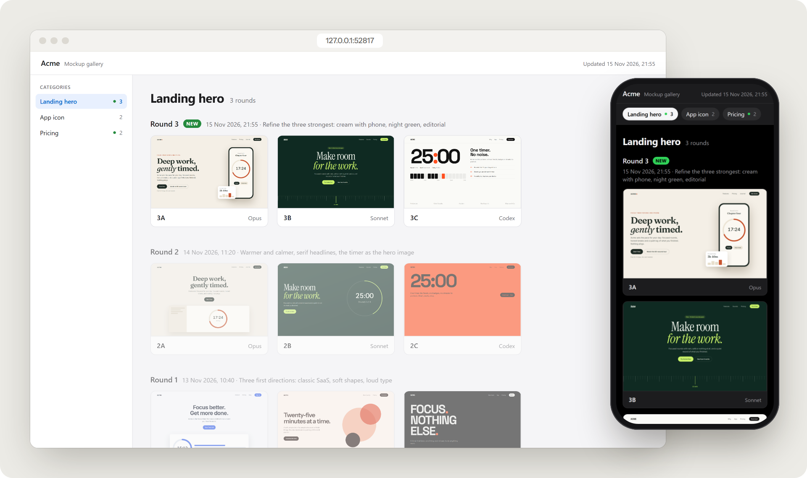

<p align="center">
  <picture>
    <source media="(prefers-color-scheme: dark)" srcset="assets/logo-dark.svg">
    <source media="(prefers-color-scheme: light)" srcset="assets/logo-light.svg">
    
  </picture>
</p>

<p align="center">
  A Claude Code plugin that files every design mockup Claude makes into one browsable gallery per project.
</p>

<p align="center">
  <a href="https://github.com/t1mvdploeg/mockup-gallery/actions/workflows/test.yml"></a>
  
  
  
</p>



Ask Claude for three logo ideas, then three more, then a pricing page, and the results end up spread over folders, chat screenshots and servers that are already gone. Mockup Gallery keeps them in one place: every batch becomes a numbered round, every variant gets a label like `3B`, and the whole history sits in a single page you can open next to your work.

## Install

In Claude Code:

```
/plugin marketplace add t1mvdploeg/mockup-gallery
/plugin install mockup-gallery@mockup-gallery
```

Requires Node.js 20 or newer. Nothing is installed in your project. Screenshots use the Chrome or Edge already on your machine; the optional public link uses [`cloudflared`](https://developers.cloudflare.com/cloudflare-one/connections/connect-networks/downloads/).

## What it does

The skill starts on its own whenever Claude makes design mockups or variants. Type `/mockup-gallery` to build the gallery and get its link.

- **Categories** (Logo, App icon, Pricing, ...) in a sidebar, each with its number of rounds.
- **Rounds**, newest on top with a `NEW` badge, older ones faded below it, each with a date, time and a one-line note on what it explores.
- **Variants** as screenshots with their label and who made them (`Opus`, `Sonnet`, `Codex`). Click one to open the HTML mockup behind it and click through it.
- A calm page with dark mode. On a phone the sidebar turns into a row of chips.

## How it works

Everything lives in your project and is committed with it:

```
mockups/gallery/
  gallery.json                  manifest, the source of truth
  index.html                    generated from the manifest, one self-contained file
  logo/round-3/3B/screenshot.png
  logo/round-3/3B/index.html    optional, self-contained
```

A label is the round number plus a letter (`3A`, `3B`), unique within its category, so "Logo 3B is better" is never ambiguous. Claude runs the commands through `scripts/gallery.mjs`:

| Command | What it does                                                                                              |
| ------- | --------------------------------------------------------------------------------------------------------- |
| `round` | Registers a round (category, note, one author per variant) and creates a folder per variant               |
| `build` | Takes the missing screenshots, regenerates `index.html`, warns about HTML that reaches outside its folder |
| `serve` | Serves only `mockups/gallery/` on a free local port and prints the link                                   |
| `share` | Opens a temporary public `cloudflared` link, only on explicit request; stops by itself after 2 hours      |
| `stop`  | Stops the server and any public link                                                                      |

All commands take `--project <root>`; without it they use the current folder.

## Viewing on a phone

When you follow along from your phone (for example through Remote Control), Claude sends the screenshots in the chat, each with its label. It never opens a public link on its own, because a project can hold real data. Only when you ask for a link does it run `share`, which gives you a `trycloudflare.com` address that serves just the gallery folder and closes after 2 hours, or sooner with `stop`.

## What it does not do

- No voting, picking or notes on the page: feedback goes through the chat.
- No import of mockups you already have; the gallery starts empty.
- No gallery across projects, no hosting, no accounts.
- No making of mockups: it organises what Claude or Codex makes.

## Licence

MIT
